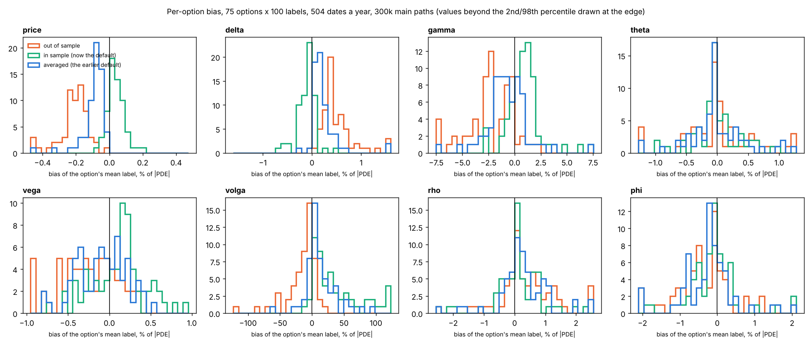
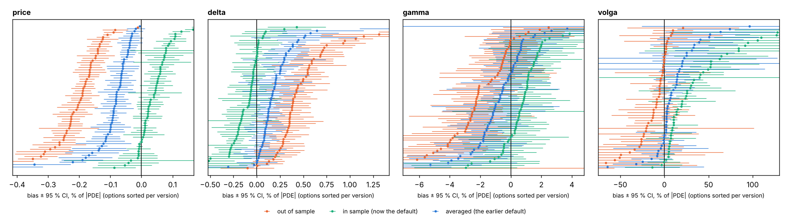

# Distribution of the bias, confidence intervals, alpha*

Not part of the paper. `experiments/diagnostics/bias_distribution.py`. Data: `results/two_per_day/raw` (75 options x 100 labels, 504 dates a year, 300k main paths, made with the pilot's rule (`exercise_rule="pilot"`) and without the exercise bound; its in-sample version is the current default label except for the bound, which only changes options with r < d). Reference: the American PDE.

Per option and Greek: bias = (mean of its labels − PDE) / |PDE|, se = sd / √n / |PDE| (n = 100), noise = sd / |PDE|, all in %. 95 % confidence interval of an option's bias: bias ± 1.96 se. Its half-width is 1.96 · noise / √n, so it depends on the noise: to pin a bias down to ±0.1 × one label's noise takes (1.96 / 0.1)² ≈ 384 labels of the option; labels to resolve the median bias = (1.96 · median noise / median |bias|)², the labels of one option needed for a typical bias to be significant. sd of bias (true) = the spread of the bias across options with the labels' own noise removed, √(var(bias) − mean(se²)). Left out: options in the exercise region and, per Greek, |PDE| < 1 % of its largest value or labels with zero noise (exact).

| Greek | version | options | median bias | IQR of bias | sd of bias (true) | median se | CI excludes 0 | median noise | labels to resolve the median bias |
|---|---|---|---|---|---|---|---|---|---|
| price | oos | 61 | -0.194 | -0.243 to -0.163 | 0.148 | 0.0203 | 100 % | 0.203 | 4 |
| price | ins | 61 | +0.0402 | +0.00894 to +0.0664 | 0.0412 | 0.0186 | 52 % | 0.186 | 73 |
| price | avg | 61 | -0.0808 | -0.102 to -0.0574 | 0.0737 | 0.0183 | 93 % | 0.183 | 20 |
| delta | oos | 64 | +0.399 | +0.32 to +0.588 | 1.03 | 0.102 | 88 % | 1.02 | 25 |
| delta | ins | 64 | -0.0729 | -0.205 to -0.0136 | 0.14 | 0.0964 | 33 % | 0.964 | 477 |
| delta | avg | 64 | +0.161 | +0.0858 to +0.286 | 0.462 | 0.0941 | 47 % | 0.941 | 120 |
| gamma | oos | 66 | -2.24 | -3.39 to -0.561 | 0 | 1.03 | 52 % | 10.3 | 79 |
| gamma | ins | 66 | +0.869 | +0.242 to +1.52 | 27.5 | 0.979 | 20 % | 9.79 | 327 |
| gamma | avg | 66 | -0.706 | -1.7 to +0.363 | 8.18 | 0.919 | 24 % | 9.19 | 273 |
| theta | oos | 61 | -0.00131 | -0.262 to +0.203 | 0.666 | 0.0536 | 70 % | 0.536 | 20 |
| theta | ins | 61 | -0.00745 | -0.161 to +0.11 | 0.356 | 0.0444 | 79 % | 0.444 | 32 |
| theta | avg | 61 | -0.0128 | -0.179 to +0.189 | 0.474 | 0.0385 | 82 % | 0.385 | 16 |
| charm | oos | 59 | -0.00309 | -1.23 to +2.86 | 4.41 | 1.44 | 39 % | 14.4 | 175 |
| charm | ins | 59 | +0.349 | -0.238 to +2.84 | 3 | 1.38 | 24 % | 13.8 | 305 |
| charm | avg | 59 | +0.094 | -0.8 to +2.83 | 3.66 | 1.38 | 32 % | 13.8 | 208 |
| vega | oos | 64 | -0.26 | -0.479 to -0.00124 | 0.18 | 0.269 | 23 % | 2.69 | 317 |
| vega | ins | 64 | +0.145 | -0.123 to +0.259 | 0 | 0.247 | 19 % | 2.47 | 461 |
| vega | avg | 64 | -0.074 | -0.334 to +0.109 | 0 | 0.238 | 11 % | 2.38 | 444 |
| volga | oos | 54 | -7.6 | -22.8 to -0.802 | 17.1 | 12 | 15 % | 120 | 671 |
| volga | ins | 54 | +24.3 | +7.82 to +52.6 | 43.1 | 11.6 | 72 % | 116 | 88 |
| volga | avg | 54 | +7.02 | +1.67 to +20.3 | 12.3 | 11.4 | 33 % | 114 | 298 |
| vanna | oos | 65 | +1.44 | -0.413 to +5.72 | 0 | 3.67 | 9 % | 36.7 | 602 |
| vanna | ins | 65 | -0.594 | -2.63 to +2.73 | 0 | 3.58 | 9 % | 35.8 | 658 |
| vanna | avg | 65 | +0.186 | -1.12 to +3.45 | 0 | 3.55 | 9 % | 35.5 | 872 |
| rho | oos | 62 | +0.306 | +0.00176 to +0.924 | 0.92 | 0.164 | 74 % | 1.64 | 38 |
| rho | ins | 62 | +0.0511 | -0.178 to +0.589 | 0.77 | 0.111 | 73 % | 1.11 | 51 |
| rho | avg | 62 | +0.188 | -0.0172 to +0.753 | 0.835 | 0.11 | 76 % | 1.1 | 42 |
| phi | oos | 62 | -0.322 | -0.685 to -0.00115 | 0.781 | 0.148 | 73 % | 1.48 | 39 |
| phi | ins | 62 | -0.0834 | -0.483 to +0.163 | 0.674 | 0.0998 | 74 % | 0.998 | 55 |
| phi | avg | 62 | -0.201 | -0.605 to +0.000348 | 0.718 | 0.0958 | 77 % | 0.958 | 48 |
| delta_r | oos | 63 | -4.09 | -10.6 to -0.483 | 29.4 | 1.39 | 68 % | 13.9 | 37 |
| delta_r | ins | 63 | -1.68 | -6.03 to +0.00135 | 9.62 | 1.29 | 51 % | 12.9 | 175 |
| delta_r | avg | 63 | -2.78 | -8.29 to -0.129 | 19.3 | 1.28 | 63 % | 12.8 | 61 |
| delta_d | oos | 60 | +3.54 | +0.202 to +9.92 | 51.6 | 1.42 | 68 % | 14.2 | 57 |
| delta_d | ins | 60 | +1.48 | -0.0848 to +5.3 | 30 | 1.28 | 48 % | 12.8 | 130 |
| delta_d | avg | 60 | +2.25 | +0.102 to +7.62 | 41 | 1.27 | 62 % | 12.7 | 92 |

## Selected widths alpha*

6609 labels of 67 options (labels in the exercise region or exact left out). alpha_S is in units of S0·σ√T, alpha_σ in units of σ; spread = coefficient of variation of alpha* over the 100 labels of an option; at the cap = share of labels whose alpha* is the upper bound (alpha_S: the pilot width min(0.25, 1.25 σ√T)·S0; alpha_σ: 0.6σ / 1.3).

| | median over options | 5–95 % of options |
|---|---|---|
| alpha_S / (S0 σ√T) | 0.282 | 0.157 – 0.382 |
| spread of alpha_S within an option | 30 % | 23 % – 40 % |
| alpha_S at the cap | 0 % | 0 % – 2 % |
| alpha_σ / σ | 0.222 | 0.16 – 0.26 |
| spread of alpha_σ within an option | 29 % | 24 % – 34 % |
| alpha_σ at the cap | 2 % | 0 % – 6 % |

Correlation, within an option, between alpha_S and the in-sample Gamma: median -0.01 over 67 options (5–95 %: -0.13 to +0.15). The pilot paths are independent of the main paths, so alpha* should not track the label's own noise; a clearly negative value would mean a selection bias (small alpha where the data look curved).

Options with the most labels at the alpha_S cap:

| option | T | σ | alpha_S / (S0 σ√T) | at the cap |
|---|---|---|---|---|
| random 12 | 0.20 | 23.6 % | 0.429 | 2 % |
| random 23 | 0.37 | 50.8 % | 0.292 | 2 % |
| check 24 | 2.00 | 40.0 % | 0.16 | 2 % |
| random 9 | 0.78 | 36.3 % | 0.24 | 2 % |
| random 10 | 1.87 | 55.7 % | 0.13 | 1 % |
